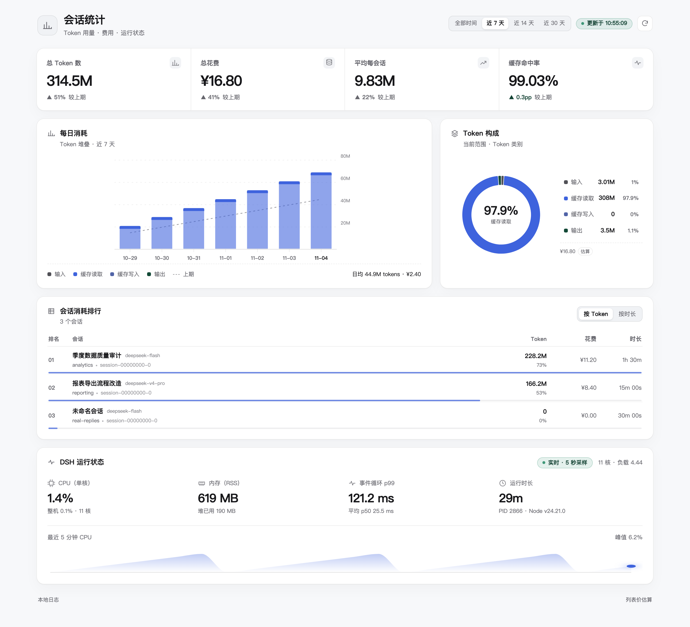
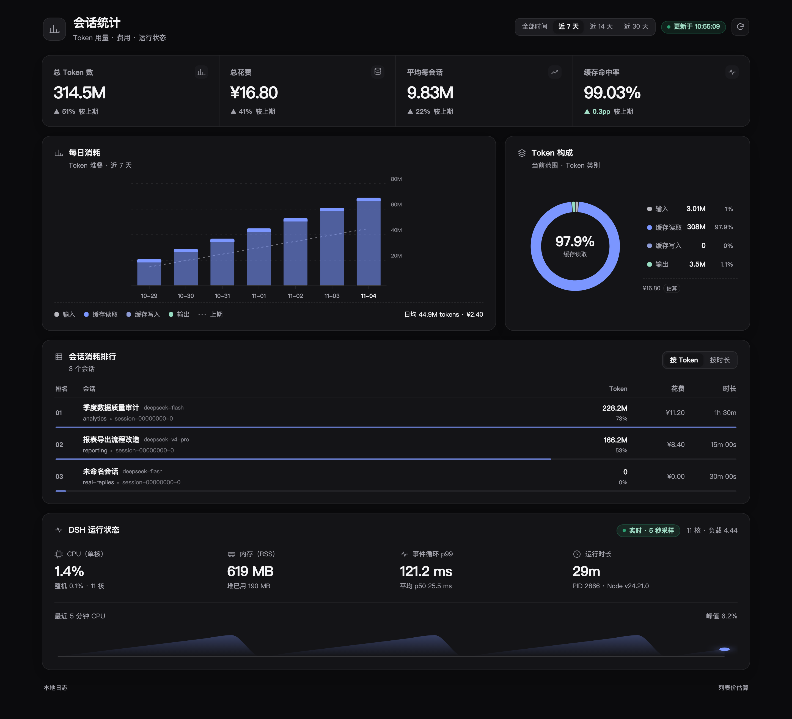
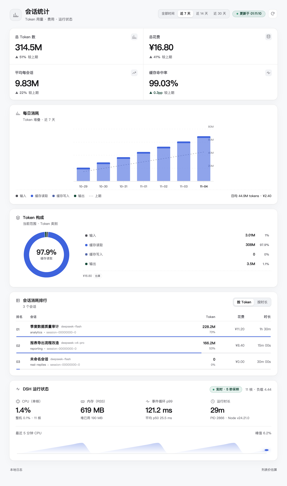
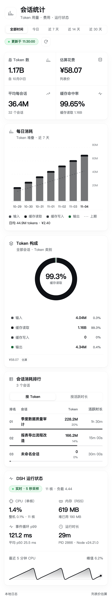
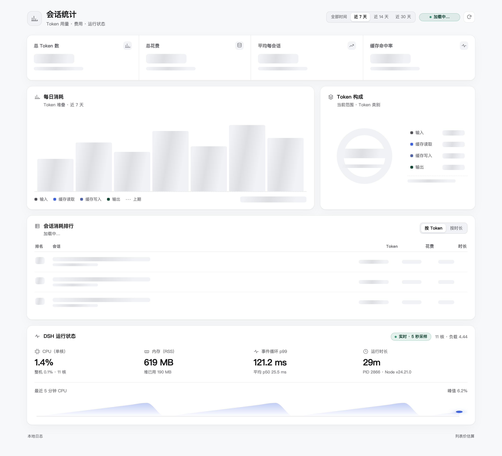

# 会话统计 · DSH Session Dashboard

[](https://github.com/starriv/dsh-session-dashboard/actions/workflows/ci.yml)
[](LICENSE)

DSH Session Dashboard 是 DeepSeek Harness Web GUI 的会话统计插件。它在本机读取
DSH 会话日志，提供 Token 用量、费用估算、每日趋势、Token 构成、会话排行和宿主
运行状态，并从左侧栏的「会话统计」进入。

界面使用 DSH 的主题变量，支持浅色、深色和窄屏布局。切换统计范围时，页面保留
现有结构，各区域显示与真实内容尺寸一致的加载占位，避免整页闪烁和布局跳动。

## 界面预览

预览使用仓库内的合成测试数据，不含真实会话内容。

| 浅色 · 1440 | 深色 · 1440 |
| --- | --- |
|  |  |

| 平板 · 1024 | 手机 · 390（无横向滚动） |
| --- | --- |
|  |  |

切换范围时的加载占位：



## 功能

| 区域 | 内容 |
| --- | --- |
| 左侧栏入口 | `sidebar.panellist` 的 `session-stats` 入口，同时对应 `main` 面板 key |
| 全局范围 | 全部时间（默认）、近 7 天、近 14 天、近 30 天 |
| 概览指标 | 总 Token、估算花费、平均每会话、缓存命中率；选择范围时显示与上一周期的变化，全部时间显示起始日期等基线信息 |
| 每日消耗 | 按 Token 类型堆叠的柱状图；虚线表示上一周期，图表底部显示日均值 |
| Token 构成 | 环形图，中心显示占比最高的类别；图例列出各项精确值与占比 |
| 会话排行 | 按 Token 或会话时长排序；每行底部显示占比条，列出 Token、占比、花费和时长 |
| 运行状态 | CPU 单核/整机占用、RSS、事件循环 p99、运行时长、PID、Node 版本和最近 5 分钟 CPU 曲线 |
| 刷新机制 | 页面打开时每 5 秒刷新；页面隐藏时暂停，恢复可见后立即刷新；失败后逐步退避；支持手动刷新 |
| 加载状态 | 切换范围时保留页面布局，各区域显示与真实内容尺寸一致的占位；图表不重播入场动画 |

## 环境要求

- DeepSeek Harness 0.2.1-rc.5 或兼容版本。
- Node.js >= 22.15（CI 覆盖 Node 22 和 24）。
- 本机存在 DSH 会话目录，默认位于 `~/.dsh/sessions`。
- 仓库内包含预构建的 `client.js`，插件管理器安装时需要该文件。

## 安装

### 从本地仓库安装

```bash
git clone https://github.com/starriv/dsh-session-dashboard.git
cd dsh-session-dashboard
npm ci
npm run build
```

在 DSH 插件管理器中执行 `install_bundle`，目标选择该仓库的绝对路径。安装完成后，
左侧栏会出现「会话统计」入口；首次打开或插件更新后刷新一次 Web GUI。

Host 侧代码（`index.js`、`host/`）修改后需要重启 DSH 宿主。Client 侧由插件管理器
加载 `client.js`。开发时也可以使用 `link:` 指向本地目录。

`npm test` 会先通过 `pretest` 重新生成 `client.js`。提交源码变更时请一并提交构建
产物；CI 会校验构建结果是否与仓库中的文件一致。

## 配置

`cordis.patch.yml` 中的 row config 均可选：

| 键 | 默认值 | 说明 |
| --- | --- | --- |
| `scope` | `all` | Host 侧默认统计范围；页面打开时仍从「全部时间」启动，以选择器为准 |
| `trendDays` | `30` | 全部时间模式下趋势图显示的天数，范围 1–90 |
| `timeZone` | `Asia/Shanghai` | 日桶划分、峰时计价和窗口边界使用的 IANA 时区 |
| `refreshMs` | `1500` | 同一份快照的最小重新扫描间隔 |
| `backgroundScanMs` | `60000` | 后台增量扫描间隔 |
| `runtimeSampleMs` | `5000` | 运行状态采样间隔 |
| `historySize` | `60` | CPU 曲线保留的历史点数 |
| `maxSessions` | `2000` | 单次扫描的会话文件上限 |
| `maxFileBytes` | `256 MiB` | 未压缩日志文件的大小上限 |
| `maxDecodedBytes` | `128 MiB` | 单文件解码后的输出上限，zstd 和 plain JSONL 均生效 |
| `rankingLimit` | `100` | 排行返回的最大条数 |
| `allowUnauthenticated` | `false` | 无 `connection` 服务时是否允许无鉴权访问；默认拒绝，仅限隔离回环部署 |
| `pricing` / `peakWindows` | 内置表 | 覆盖模型价格或峰时窗口，无需修改代码 |

`scope` 只影响 Host 侧默认快照范围，打开面板后由界面选择器决定。
`allowUnauthenticated` 会关闭元数据路由的鉴权，不应在可被网络访问的 Host 上启用。

## 数据口径

- **数据源**：`$DSH_HOME/sessions/<workspace>/<session>/session.vN.jsonl[.zstd]`，
  选择最高代际，压缩格式优先；多帧 zstd 逐帧解压。
- **Token**：只统计 provider usage 中的 `inputTokens`、`outputTokens`、
  `cacheReadTokens` 和 `cacheWriteTokens`，总量为四项之和。
- **重试与流式响应**：同一 `(turn, step)` 的后续样本替换旧样本；
  `llm/retry-started` 结束当前替换槽；`assistant/attempt` 读取流内最后一个 usage。
- **分叉会话**：按 `session/end-seed` 的 `seq` 截断继承前缀，兼容历史 `seedLength`。
- **时间窗口**：按 `timeZone` 的自然日划分；所选范围的每日合计与概览总量一致；
  上一周期是与当前范围相邻、长度相同的窗口。
- **去重**：同一 header `id` 的复制或恢复会话只计最新一份。
- **缓存命中率**：`缓存读取 /（缓存读取 + 输入未命中）`。
- **费用**：每个样本按时间和模型计价，峰时与空闲分别取价；默认使用 CNY 列表价快照，
  结果为估算值，不代表平台账单。

峰时窗口默认为 `Asia/Shanghai` 工作日 09:00–12:00 和 14:00–18:00。原有 DeepSeek
模型及兜底模型空闲时段按半价计算；`flat: true` 的模型不享受隐式峰谷折扣。
`pricing` 支持部分覆盖，也可用 `null` 禁用某个模型；`peakWindows` 支持数字分钟或
`HH:MM` 格式。

### GPT-6 Astra 估算与上下文阶梯

`gpt-6-astra` 不再落入 Flash 兜底。内置价格来自
[Token Usage 同源社区价表](https://github.com/LaoYueHanNi/model-price-table) 的 v130 快照
（`updatedAt: 1793784668`），不是供应商实际账单，也不会自动联网同步。

| CNY / 百万 Token | 输入未命中 | 输出 | 缓存读取 | 缓存写入 |
| --- | ---: | ---: | ---: | ---: |
| 输入侧上下文 < 272,000 | 70 | 350 | 7 | 87.5 |
| 输入侧上下文 >= 272,000 | 140 | 525 | 14 | 175 |

输入侧上下文 = **每次请求**的输入未命中 + 缓存读取 + 缓存写入，不含输出。
达到阈值时整次请求使用高档价格，不是只对超出部分加价，也不按会话累计用量选档。
Astra 全天、周末同价；`gpt-6-astra-fast` 等变体不会被当作 Astra 别名。

价格条目支持 `flat: true` 与 `contextTiers: [{ threshold, peak, idle? }]`；选择达到的
最高阈值。部分覆盖继承已有价格及档位，显式 `contextTiers: []` 关闭阶梯。
`provider/model` 覆盖仍优先于裸模型名。有效档位及快照来源包含在 `pricing` 响应中。

此次变更不修改其他模型的原有兜底、Token 归并或辅助调用统计范围。价格代码更新后
需重新加载插件，重建内存中的历史计价缓存；仅刷新浏览器不会重算旧 Host 缓存。

## 安全与隐私

- `/dsh-session-stats/snapshot` 返回会话标题、cwd、token 和费用；
  `/dsh-session-stats/ping` 返回插件与扫描状态。两者使用相同的鉴权校验。
- 组合中存在 DSH `connection` 服务时，复用其 Host/Origin 校验、浏览器
  Cookie/API 凭证和连接准入；无 Cookie 的 `curl` 请求返回 401。
- 没有 `connection` 服务时默认拒绝访问，返回 `503 auth-unavailable`。
  仅在已有一层访问边界保护的隔离回环部署中，才应显式启用
  `allowUnauthenticated`。
- 路由只接受 `GET` 和 `HEAD`；请求参数不会进入文件路径；发现流程跳过符号链接。
- 文件大小、解码输出、会话数量和排行条数均有上限。单个文件失败会计入 `errors`
  并在页面提示，不会清空已有统计。
- 响应包含 `cache-control: no-store` 和 `x-content-type-options: nosniff`；
  内部错误只写入 Host 日志，不返回给浏览器。
- 完整威胁模型和漏洞报告方式见 [SECURITY.md](SECURITY.md)。

## 构建、测试与发布

```bash
npm ci
npm run build
npm test
npm pack --dry-run
```

- **模块格式**：`client.js` 使用 `window.__ModuleLoader__.load({ id, factory })`；
  `react` 和 `react/jsx-runtime` 作为外部依赖，d3 打包进产物。
- **构建可复现**：仓库提交了 `client.js` 和 `package-lock.json`。CI 在 Ubuntu
  Node 22/24 和 macOS Node 22 上执行 `npm ci`、`npm test`、`npm pack --dry-run`，
  并检查重建后的 `client.js` 与提交文件无差异。
- **测试覆盖**：33 个 Node 测试，覆盖真实日志与官方 `tokenUsage` 对账、zstd
  多帧/截断/损坏、重试与分叉、上期窗口、鉴权默认拒绝、异常 usage/time 样本、
  重复 id、plain JSONL 预算、SSR/DOM、范围切换加载占位、locale 和构建模块格式。
  依赖 `~/.dsh/sessions` 的真实日志测试在无会话时跳过；合成数据测试仍会执行。
- **发布内容**：`npm pack` 包含 Host、client、locale、icon、manifest、README、
  docs 截图和法律文件。`private: true` 表示该包不通过 npm 公共注册表发布。

## 已知限制

- 费用为本地估算；价格或峰时策略变化时，请使用 `pricing` 或 `peakWindows` 覆盖。
- 当前直接读取会话文件，而非通过 Session 服务；正在追加的尾部帧会在下一次扫描时计入。
- 历史 v0–v3 日志若尚未迁移到当前格式，usage 行可能无法完整解析。
- 首次冷扫描在 Host 主线程执行 JSON 解析；已设置文件、解码和数量上限，但超大历史
  仍可能造成一次短暂卡顿。
- 全量扫描上限按路径排序，会话数量极多时可能遗漏部分旧会话；页面会显示截断提示。
- 页面固定从「全部时间」启动，Host 的 `scope` 默认值不会改变界面的初始选择。
- 预览截图来自合成测试数据和 Host 主题变量的静态渲染，不是登录态实时界面。

## 贡献与许可

- [CONTRIBUTING.md](CONTRIBUTING.md)
- [CHANGELOG.md](CHANGELOG.md)
- [SECURITY.md](SECURITY.md)
- [THIRD_PARTY_NOTICES.md](THIRD_PARTY_NOTICES.md)

MIT © 2026 DSH Session Stats contributors.

界面设计参考了 MIT 许可的
[dashboard-design skill](https://github.com/abdiraimov-otabek/dashboard-design-skill)；
本仓库的实现代码为独立编写。
